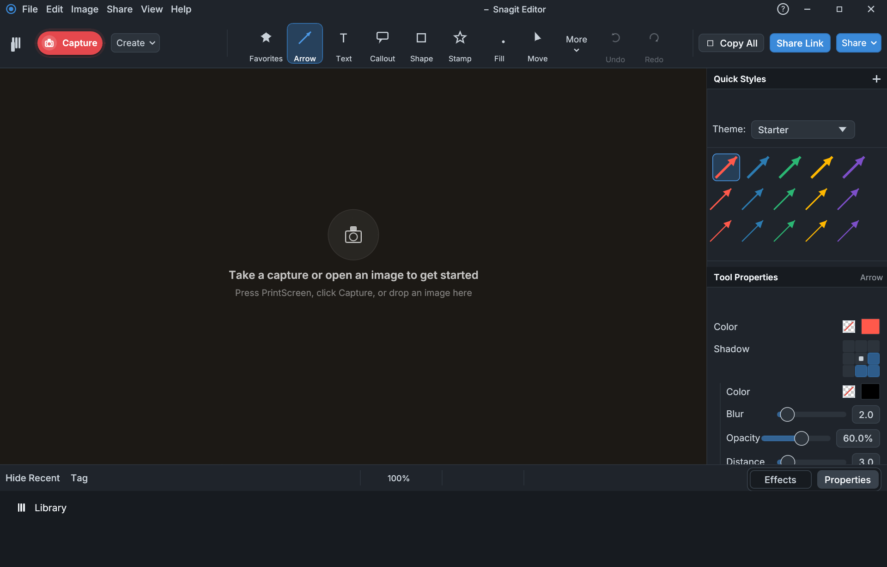
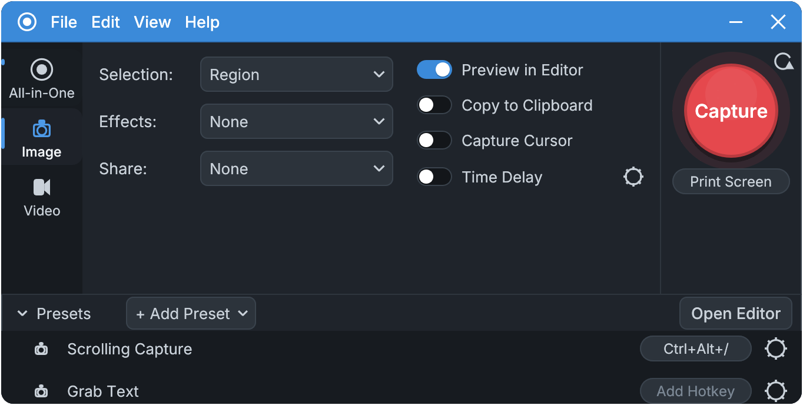
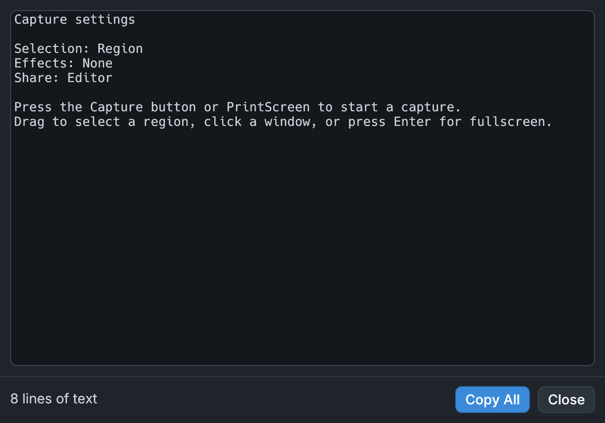
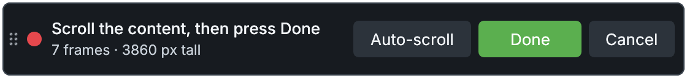

<p align="center">
  
</p>

<h1 align="center">LinkShot</h1>

<p align="center">
  The free, open-source <b>Snagit alternative for Linux and Windows</b>: screenshots, scrolling capture,
  screen recording with audio and webcam, OCR text grab and a vector image editor in one app.
  Press Print Screen, pick a region, done.
</p>

<p align="center">
  <a href="https://github.com/ZeroDay-Labz/linkshot/releases/latest"></a>
  <a href="https://github.com/ZeroDay-Labz/linkshot/actions/workflows/ci.yml"></a>
  <a href="https://github.com/ZeroDay-Labz/linkshot/releases"></a>
  <a href="LICENSE-MIT"></a>
</p>

<p align="center">
  
</p>

Every download is self-contained: video export (ffmpeg) and text recognition (Tesseract) ship inside the
package, so nothing else has to be installed. LinkShot is developed by
[ZeroDay-Labz](https://github.com/ZeroDay-Labz) and licensed under MIT OR Apache-2.0.

## Download

Releases are on the [Releases](https://github.com/ZeroDay-Labz/linkshot/releases) page:

| Platform | File | Install |
| --- | --- | --- |
| Windows 10/11 (x64) | `LinkShot-<version>-windows-x64.exe` | Run it. The first start unpacks the bundled tools into `%LOCALAPPDATA%\LinkShot\tools`. Windows SmartScreen may warn because the file is not code-signed; choose *More info ▸ Run anyway*. |
| Fedora / RHEL / openSUSE | `linkshot-<version>.x86_64.rpm` | `sudo dnf install ./linkshot-<version>.x86_64.rpm` |
| Debian / Ubuntu / Mint | `linkshot_<version>_amd64.deb` | `sudo apt install ./linkshot_<version>_amd64.deb` |
| Any Linux (Flatpak) | `LinkShot-<version>.flatpak` | `flatpak install --user LinkShot-<version>.flatpak` (needs the Flathub remote for the runtime) |

## Why LinkShot

Linux has good screenshot tools (Spectacle, Flameshot, Ksnip, GNOME Screenshot) and good screen recorders
(OBS Studio, Kooha, Peek, SimpleScreenRecorder), but nothing that does what Snagit, ShareX or Greenshot do
on Windows in one place. LinkShot is that tool, on Linux (KDE Plasma, GNOME and other Wayland or X11
desktops) and on Windows:

* **Screenshot** a region, window, full screen, fixed region or the clipboard, with the cursor, a delay,
  an interval or a schedule, from a frozen-screen overlay that spans every monitor.
* **Scrolling screenshot** of whole web pages, documents and long lists, stitched pixel-exactly at native
  resolution, sticky headers and footers handled.
* **Screen recorder** to animated GIF or MP4 with microphone, system audio ("what you hear"), a webcam
  overlay and Screen Draw annotations; pause, resume, in/out points, lossless master kept for re-export.
* **OCR / grab text** from any part of the screen with the bundled Tesseract.
* **Image editor** with arrows, callouts, shapes, text, steps, stamps, highlights, blur, magnify, crop,
  cut out (remove a band and join the rest with a torn, wave or seamless seam), effects, quick styles
  and undo, where annotations stay editable objects. Captures are saved as `.snagx`
  (the same container layout Snagit uses, so a Snagit library opens in LinkShot) or exported as PNG, JPG,
  GIF, WebP, TIFF, BMP and ICO.
* **Share** to file, clipboard, email, printer or any program, with presets, hotkeys and a tray icon.

## What it does

* **Capture window** with All-in-One / Image / Video tabs, presets with hotkeys, time delay, interval and
  scheduled captures, a big red Capture button and a presets drawer.
* **Region / window / fullscreen / fixed-region / clipboard / file captures** from a frozen-screen overlay
  with crosshair, window highlight, magnifier (M), aspect locks (Shift / Ctrl / Ctrl+Shift), dimension boxes
  and the All-in-One HUD (Image / Video / Scrolling). The overlay covers every monitor at once and a region
  may span screens.
* **Scrolling capture**: choose *Scrolling* in the HUD or the *Scrolling Capture* preset (Ctrl+Alt+/), scroll
  the page yourself or press *Auto-scroll*, then *Done*. Frames are grabbed at native resolution and
  stitched pixel-exactly: sticky headers/footers kept once, pinned toolbars kept at their real position,
  scrollbars ignored, upward and horizontal scrolling supported, and a frame that overlaps nothing is
  reported ("Lost the overlap – scroll back a little") rather than guessed at.
* **Video recording**: *Video* in the HUD or the Video tab, Record / Pause / Stop toolbar with countdown and a
  frame around the region, Shift+F9 pause / Shift+F10 stop. Frames are grabbed at native resolution at
  10/20/30 fps with the pointer and spooled losslessly. **Microphone and system audio** ("what you hear")
  are recorded alongside (toolbar switches, M or Ctrl+Shift+M mutes the mic, a level meter and a muted
  alert), the **webcam** goes in a corner or full screen (circle / rounded / square, W hides it,
  Ctrl+Shift+F swaps), and **Screen Draw** (D or Ctrl+Shift+D) lets you draw arrows, squares and numbered
  steps on the recording that fade after a few seconds. Recording a whole monitor shrinks the toolbar
  to a small bar. The Editor plays the recording with sound (scrubber, frame stepping, in/out points,
  mute) and saves it as an **animated GIF** (default; presets Screen Video / High Motion / Reduced File
  Size / Custom) or **MP4** (H.264 + AAC through the bundled ffmpeg). Exports always start from the
  lossless master. Existing GIF/MP4 files open in the player too, with their sound track.
* **Grab Text**: the *Grab Text* selection mode or Edit ▸ Grab Text extracts text with the bundled
  Tesseract into a results window with Copy All.
* **Editor**: Move, Arrow, Line, Shape, Highlight, Text, Callout, Step, Stamp (a built-in set plus your
  own PNGs), Pen, Blur, Magnify, Fill, Crop, Cut Out and Selection tools with properties and quick styles (themes
  with import/export); undo/redo; arrange; flatten; effects (border, shadow, edges, filters, colour
  adjustment, colour replacement, scale, trim); rotate/flip; resize; canvas colour; recent-captures tray
  with pinning; library browser; Copy All; Save / Save As (SNAGX, PNG, JPG, GIF, BMP, TIF, WebP, ICO);
  share to File / Clipboard / Program / Email / Printer; File ▸ Print. Dark mode is the default
  (View ▸ Theme), the UI uses the bundled Inter font and renders at the display's native pixel density.
* **Capture options**: Capture Cursor (still images too), a "Capturing in N" countdown for
  delayed captures, video-size guides (G) and arrow-key nudging in the selection overlay, Window selection
  on KDE Plasma Wayland, and per-effect options (border colour and width, shadow size and direction, edge
  style and sides, filter, trim tolerance) for capture-time effects. Hotkeys are editable in Preferences.
* **Print Screen, system-wide**: on first start LinkShot offers to become the default screenshot tool.
  On KDE Plasma and GNOME the desktop then launches a LinkShot capture on Print Screen even when LinkShot
  is closed (Spectacle's or the Shell's Print binding is cleared; other shortcuts are kept), and on Windows
  the "Print screen key opens Snipping Tool" option is turned off. LinkShot also starts at login. On compact
  keyboards the key is Fn+PrtSc. Preferences ▸ Capture has the switch.
* **Desktop integration**: global hotkeys (X11 and Windows natively; Wayland through the GlobalShortcuts
  portal), tray icon (left click opens the Capture window, middle click captures), one instance per user
  (launching again raises the running Capture window; `linkshot --capture` starts a capture from a script),
  prompt-free capture on KDE Plasma Wayland (KWin `ScreenShot2`), the XDG Screenshot portal on other Wayland
  desktops, `xcap` on X11 and Windows.

Not yet: Simplify, Magic Wand, Eraser, templates, cloud share destinations (Imgur, Nextcloud), webcam
and system audio inside the Flatpak on desktops without PipeWire or PulseAudio.

## Screenshots

<p align="center">
  
  
</p>
<p align="center">
  
</p>

## Building from source

```sh
cargo build -p linkshot --release          # Linux
cargo test                                 # format, spool and GIF encoder tests
cargo run -p linkshot -- --selftest        # drives capture -> editor -> save -> record -> GIF/MP4 headlessly
cargo run -p linkshot -- --shots DIR       # renders the UI to PNGs without a display
```

Linux build dependencies (Fedora names): `gtk3-devel libxcb-devel libxkbcommon-devel wayland-devel
pipewire-devel dbus-devel fontconfig-devel mesa-libgbm-devel`.

### Packages

The bundled third-party tools (see [`packaging/THIRD-PARTY.md`](packaging/THIRD-PARTY.md)) are fetched once:

```sh
./packaging/fetch-tools.sh && ./packaging/make-bundles.sh
cargo deb -p linkshot                       # dist: target/debian/*.deb
cargo generate-rpm -p linkshot              # dist: target/generate-rpm/*.rpm
./packaging/build-windows.sh                # dist/LinkShot-<version>-windows-x64.exe (cargo-zigbuild + zig)
flatpak run org.flatpak.Builder --user --force-clean --install-deps-from=flathub \
    --repo=packaging/flatpak/repo packaging/flatpak/build packaging/flatpak/io.github.zerodaylabz.LinkShot.yml
flatpak build-bundle packaging/flatpak/repo dist/LinkShot-<version>.flatpak io.github.zerodaylabz.LinkShot
```

A system `ffmpeg` or `tesseract` is used when the bundle is missing (development builds), and
`LINKSHOT_FFMPEG` / `LINKSHOT_TESSERACT` / `LINKSHOT_TOOLS` override the lookup.

See [`docs/ARCHITECTURE.md`](docs/ARCHITECTURE.md) for the crate layout and the window model, and
[`docs/IMPROVEMENT-PLAN.md`](docs/IMPROVEMENT-PLAN.md) for the prioritised list of known problems and planned work.

`cargo run -p linkshot-capture --example defaulttool -- status|make|undo` inspects or changes the system-wide Print Screen binding without the GUI.
